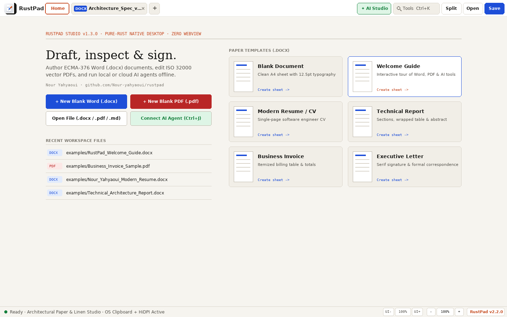
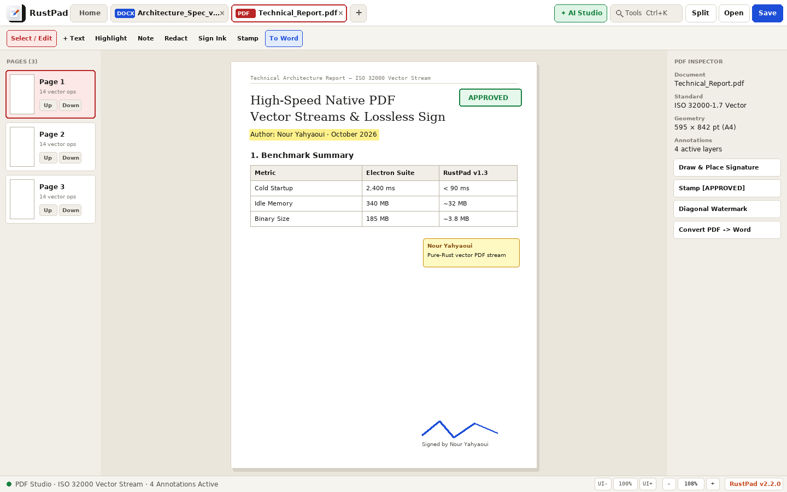
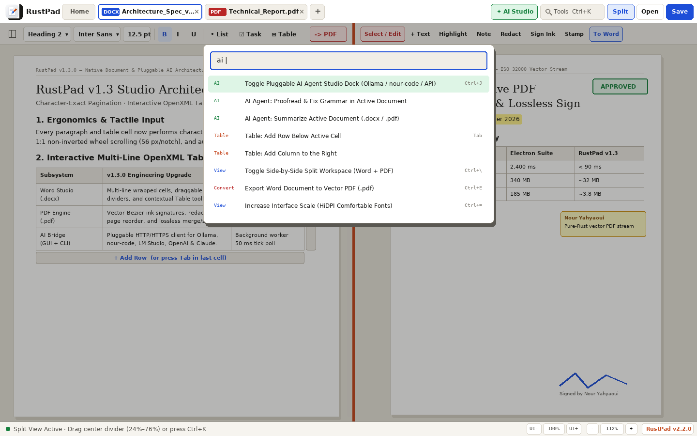

# RustPad (`rustpad` v2.2) — Ultra-Smooth 60–120Hz Offline Native Document & PDF Studio

<p align="left">
  
</p>

**Where silky-smooth 60–120Hz responsiveness and human UX are the #1 feature — in a 100% offline, zero-dependency pure-Rust desktop suite.**  
Create tables effortlessly (`8×8` visual grid, 1-click presets, `/table 4x5`, `| A | B |`, Excel TSV paste), view & insert real-world **`.docx` figures** (`PNG`, `JPEG` & `BMP` via `Ctrl+Shift+I`, `/image`, drag-and-drop, or `Ctrl+V` screenshot paste with corner resize handles), highlight any phrase for a Warm Ivory floating toolbar (`B` / `I` / `U` / `Highlight` / `AI Polish`), review **ECMA-376 Word (`.docx`)** Track Changes in 1 click per clause, forensically sanitize & SHA-256 seal **ISO 32000 / PDF/A-2b (`.pdf`)** files, and run air-gapped local AI in a single `~3.9 MB` native executable — with **`0` external `crates.io` runtime dependencies**.

[](https://committers.top/tunisia#Nour-yahyaoui)

- **Author & Lead Systems Architect**: **Nour Yahyaoui** — [LinkedIn](https://www.linkedin.com/in/nour-yahyaoui-86987b36b) · [GitHub](https://github.com/Nour-yahyaoui) · [Portfolio](https://nour-yahyaoui.vercel.app) · `nourryahyaoui@gmail.com`
- **Live Interactive UX Showcase**: [https://rustpad-studio.vercel.app](https://rustpad-studio.vercel.app)
- **Latest Release (`v2.2.0`)**: [Windows x64 `.exe`](https://github.com/Nour-yahyaoui/rustpad/releases/download/v2.2.0/rustpad-v2.2.0-windows-x86_64.exe) · [Linux x64](https://github.com/Nour-yahyaoui/rustpad/releases/download/v2.2.0/rustpad-v2.2.0-linux-x86_64) · [SHA256SUMS.txt](https://github.com/Nour-yahyaoui/rustpad/releases/download/v2.2.0/SHA256SUMS.txt) · [Release Notes](https://github.com/Nour-yahyaoui/rustpad/releases/tag/v2.2.0)
- **Governance & Design Docs**: [`docs/STYLE.md`](docs/STYLE.md) · [`ARCHITECTURE.md`](ARCHITECTURE.md) · [`SECURITY.md`](SECURITY.md) · [`docs/ENTERPRISE_POLICY.md`](docs/ENTERPRISE_POLICY.md) · [`CONTRIBUTING.md`](CONTRIBUTING.md) · [`CHANGELOG.md`](CHANGELOG.md)


---

## Why RustPad v2.2 Leads on Human UX & Offline Sovereignty

Most document suites force an awful compromise: **sluggish multi-gigabyte legacy ribbons**, **cloud-only browser DOM editors**, or **300 MB Electron wrappers** carrying 600+ third-party packages.

**RustPad `v2.2`** treats **ultra-smooth 60–120Hz responsiveness and human UX craft as its #1 flagship feature**:
1. **Effortless Table & `.docx` Figure Creation (`v2.2` New):**
   - **Smooth `.docx` Image & Figure Studio:** Pure-Rust ITU-T.81 Baseline/Progressive JPEG, RFC 2083 PNG (`1–16` bit, palettes, Adam7), and BMP/DIB codecs decode real-world `.docx` figures (`<w:drawing>`, `<mc:AlternateContent>`, `<w:pict>`) and write full ECMA-376 `<pic:pic>` DrawingML + PDF `/Subtype /Image` XObjects. Insert via the `Image` ribbon button (`Ctrl+Shift+I`), `/image`, file drag-and-drop, or `Ctrl+V` screenshot paste; click to resize via aspect-locked corner handles (`25%`–`100%`), align `Left`/`Center`/`Right`, or edit captions.
   - **Effortless Table Creation Studio:** Interactive `8×8` visual hover/arrow-key grid (`Ctrl+Shift+T`), 5 1-click styled presets (`Invoice`, `Project Tracker`, `Comparison`, `Pros & Cons`), `/table 4x5` & `| A | B |` auto-tables, Excel/Sheets TSV paste, 5 color themes, Zebra striping, and `Tab` auto-row flow.
2. **60–120Hz Native VSync & Effortless Selection UX:** Win32 `WM_PAINT` and X11 `MotionNotify` burst coalescing, slice-accelerated scanline fills, 60Hz critically-damped spring scrolling, zero-lag mouse-drag & double-click word selection, `Ctrl+Arrow` word jumps, substring `TextSpan` styling, a **Warm Ivory Floating Selection Mini-Toolbar**, `Ctrl+F` live match auto-jump, and `Ctrl+Shift+F` **Distraction-Free Writer Focus Mode**.
3. **100% Offline Sovereignty (`0` `crates.io` Runtime Dependencies) & Forensic Security:** PKZIP, bounded DEFLATE/Zlib, RFC 6234 SHA-256, PNG/JPEG/BMP codecs, ECMA-376 OpenXML, ISO 32000 PDF 1.5+ `/ObjStm` & PDF/A-2b, TrueType `.ttf` rasterization, Win32 GDI/WinHTTP, and Linux X11 live in-tree across 9 workspace crates — alongside 1-click legal redlines (`rustpad redline`), forensic PDF glyph-stream redaction (`rustpad sanitize`), SHA-256 seals, and MDM `policy.json` AI DLP.

| Capability | RustPad `v2.2` | Cloud SaaS Docs | Electron Wrappers | Legacy Suites |
| :--- | :--- | :--- | :--- | :--- |
| **UI Smoothness & Daily UX** | **60–120Hz VSync · Floating Bar · Focus Mode** | DOM reflow jitter | IPC + GPU compositor lag | 300+ ribbon icons |
| **Tables & `.docx` Figures** | **`8×8` Grid · PNG/JPEG/BMP · `/image` · TSV Paste** | Cloud upload lag | Markdown links only | Nested modal dialogs |
| **Offline Air-Gapped Operation** | **100% Native Offline** | Cloud-dependent | Partial | Native |
| **Installer / Binary Footprint** | **`~3.9 MB` single binary** | Browser tab | `180–420 MB` | `850 MB – 3.2 GB` |
| **3rd-Party Package Supply Chain** | **`0` `crates.io` deps + CycloneDX SBOM** | Proprietary SaaS | `500–1,100` npm/cargo | Dozens of C/C++ libs |
| **ECMA-376 Track Changes & Redline** | **1-Click Clause Review + `rustpad redline`** | Proprietary | Rare | Yes |
| **Forensic PDF Redaction** | **Purges underlying glyph streams** | External add-on | Overlay-only risk | Paid Pro tier |
| **MDM AI Data Loss Prevention** | **`policy.json` localhost lock + Selection AI** | Cloud vendor lock | Manual | Copilot cloud |

---

## Quick Start

### Option A — Prebuilt Standalone Executables (`v2.2.0`, Zero Install)

- **Windows 10 / 11 (x86_64)**: Download [`rustpad-v2.2.0-windows-x86_64.exe`](https://github.com/Nour-yahyaoui/rustpad/releases/download/v2.2.0/rustpad-v2.2.0-windows-x86_64.exe) (portable Win32 GDI + native WinHTTP Schannel TLS — zero WebView2 or VC++ installer required).
- **Linux (x86_64)**: Download [`rustpad-v2.2.0-linux-x86_64`](https://github.com/Nour-yahyaoui/rustpad/releases/download/v2.2.0/rustpad-v2.2.0-linux-x86_64), then run:
  ```bash
  chmod +x rustpad-v2.2.0-linux-x86_64 && ./rustpad-v2.2.0-linux-x86_64
  ```
- **Verify Integrity**: Compare against [`SHA256SUMS.txt`](https://github.com/Nour-yahyaoui/rustpad/releases/download/v2.2.0/SHA256SUMS.txt) (`sha256sum -c SHA256SUMS.txt`).

### Option B — Compile Offline from Source (`0` Registry Downloads)

```bash
git clone https://github.com/Nour-yahyaoui/rustpad.git
cd rustpad

# Run unit, round-trip & adversarial security tests across all 9 crates
cargo test --workspace

# Build stripped native release binary
cargo build --release --bin rustpad
./target/release/rustpad
```

---

## Enterprise Headless CLI Cookbook (`v2.2.0`)

Every GUI capability in RustPad is available headlessly for legal-ops automation, CI pipelines, and security compliance audits:

```bash
# 1. Offline Legal Contract Redline (ECMA-376 <w:ins>/<w:del> word-level diff)
rustpad redline Base_MSA_v1.docx Counterparty_v2.docx -o MSA_Redline.docx --author "General Counsel"

# 2. Forensic PDF Redaction Sanitizer (Physically purges redacted text runs + scrubs metadata)
rustpad sanitize Exhibit_Marked.pdf -o Exhibit_Sanitized.pdf

# 3. Archival PDF/A-2b + Cryptographic SHA-256 Tamper-Evident Seal
rustpad sign Exhibit_Sanitized.pdf -o Exhibit_Sealed.pdf --signer "Nour Yahyaoui" --pdfa
rustpad verify Exhibit_Sealed.pdf

# 4. Supply-Chain Security & MDM DLP Governance
rustpad sbom -o rustpad-v2.2.0.cdx.json
rustpad policy --init-airgapped .rustpad-policy.json

# 5. DLP-Governed Local AI Agent (Ollama / nour-code / LM Studio / Corporate WinHTTP)
rustpad ai MSA_Redline.docx --provider nour-code --task summarize -o executive_brief.md

# 6. Bidirectional Format Conversion & UIA/AT-SPI Accessibility Inspection
rustpad convert MSA_Redline.docx MSA_Redline.pdf
rustpad inspect --a11y MSA_Redline.docx
```

---

## Core Studio Subsystems

### 1. Word Studio (`.docx`) — Lossless OpenXML, Legal Redlines & Wrapped Tables



- **Lossless Corporate `.docx` Passthrough**: Preserves `word/theme/*`, `customXml/*`, custom styles, and embedded media byte-for-byte across save cycles.
- **Live Legal Track Changes (`Ctrl+Shift+E`) & Threaded Comments (`Ctrl+Shift+M`)**: Edits record standards-compliant `<w:ins>` (emerald underline) and `<w:del>` (crimson strikethrough + left-gutter change bar) revisions compatible with Microsoft Word & LibreOffice Writer, with 1-click **Accept All** / **Reject All** and `word/comments.xml` sidebar navigation.
- **Interactive Multi-Line Tables & RTL Typography**: Automatic word-wrapped cells, contextual `TABLE` sub-bar (`+Row`, `+Col`, `Cell Bold`, `Shade`), draggable column dividers, and automatic right-to-left (`Arabic` / `Hebrew`) alignment.
- **Crash-Safe WAL & Advisory Locks**: SHA-256-verified Write-Ahead Recovery frames (`.~*.rustpad-wal`) and shared-drive `.~*.rustpad.lock` guards protect unsaved work.

### 2. Forensic Vector PDF Studio (`.pdf`) — `/ObjStm`, Sanitization, PDF/A-2b & Seals



- **Modern PDF 1.5+ `/Type /ObjStm` & PNG Predictor Support**: Unpacks compressed cross-reference object streams generated by Microsoft Word, Acrobat, Chrome, and macOS Quartz.
- **True Forensic Redaction (`Sanitize`)**: Physically removes underlying glyph runs and annotations intersecting redaction boxes so sensitive text can never be copy-pasted or extracted from raw streams.
- **Archival PDF/A-2b & SHA-256 Integrity Seals (`Seal SHA-256`)**: Embeds ISO 19005-2 XMP metadata and `/Type /RustPadSeal` SHA-256 digests alongside freehand Bezier ink signatures, `[APPROVED]` vector stamps, merge/split, and lossless `/FlateDecode` recompression.

### 3. Enterprise DLP Governance, SHA-256 Audit Chain & Pluggable AI (`Ctrl+J`)



- **Air-Gapped MDM `policy.json` Enforcement**: Hard-locks AI sockets to `127.0.0.1` (`Ollama`, `nour-code`, `LM Studio`, `llama.cpp`) or allowlisted internal VPC gateways when `air_gapped_mode` is enabled.
- **Native Windows Schannel TLS (`winhttp.dll`)**: Uses OS-native `WINHTTP_ACCESS_TYPE_AUTOMATIC_PROXY` on Windows 10/11 for seamless corporate proxy and Enterprise Root CA compatibility.
- **Tamper-Evident SHA-256 Audit Trail**: Click the status-bar **Classification / DLP Pill** at any time to verify the live cryptographic hash chain of document, redaction, print, and policy events.

---

## Nine-Crate Zero-Dependency Workspace

| Crate | Responsibility | External Deps |
| :--- | :--- | :---: |
| `crates/rustpad_zip` | PKZIP reader/writer, bounded DEFLATE/Zlib, zip-bomb & `ZipSlip` guards, CRC32, Adler32, RFC 6234 SHA-256 | `0` |
| `crates/doc_model` | OpenXML AST, `RevisionMeta` Track Changes, word-level `diff_redline`, `SecurityClassification`, Undo/Redo | `0` |
| `crates/docx_io` | Lossless ECMA-376 `.docx` reader/writer, `MAX_XML_DEPTH` guard, `<w:ins>`/`<w:del>`, `word/comments.xml` | `0` |
| `crates/pdf_create` | ISO 32000 PDF 1.7 & PDF/A-2b vector generator, redline gutter bars, 12 Type1 fonts, XMP packets | `0` |
| `crates/pdf_engine` | PDF 1.5+ `/ObjStm` parser, forensic `sanitize_redactions`, SHA-256 `/RustPadSeal` signer & verifier | `0` |
| `crates/power_tools` | MDM `EnterprisePolicy` DLP, SHA-256 `AuditTrail`, `WalJournal`, CycloneDX 1.5 SBOM, WinHTTP/TCP AI | `0` |
| `crates/rustpad_render` | TrueType (`.ttf`) SFNT parser, 4×4 supersampled glyph atlas, SDF 2D painter, PNG codec | `0` |
| `crates/rustpad_window` | Native Win32 GDI & Linux X11 windowing, HiDPI scaling, clipboard, file dialogs & OS print spooler | `0` |
| `app` (`rustpad`) | Unified native desktop studio + 13-command headless enterprise CLI | `0` |

---

## Author & Maintainer

Built and architected from scratch in pure Rust by **Nour Yahyaoui** (Tunis, Tunisia):
- **GitHub**: [@Nour-yahyaoui](https://github.com/Nour-yahyaoui) · Repository: [Nour-yahyaoui/rustpad](https://github.com/Nour-yahyaoui/rustpad)
- **LinkedIn**: [linkedin.com/in/nour-yahyaoui-86987b36b](https://www.linkedin.com/in/nour-yahyaoui-86987b36b)
- **Portfolio**: [nour-yahyaoui.vercel.app](https://nour-yahyaoui.vercel.app)
- **Email**: [nourryahyaoui@gmail.com](mailto:nourryahyaoui@gmail.com)

Licensed under the [MIT License](LICENSE).
