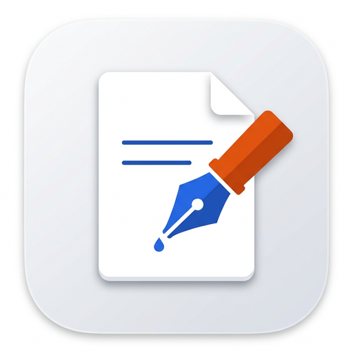

<div align="center">
  
  <h1>RustPad</h1>
  <p><strong>100% Pure-Rust Native Word (<code>.docx</code>) & PDF (<code>.pdf</code>) Desktop Studio</strong></p>
  <p>
    <a href="LICENSE"></a>
    <a href="docs/TECH_STACK.md"></a>
    <a href="docs/UI_UX_LIGHT_THEME.md"></a>
    <a href="#author--contact"></a>
  </p>
</div>

---

## Overview

**RustPad** is a fast, standalone, offline-first **native desktop document studio** built **100% in Pure Rust** — zero web server, zero HTML/CSS/JavaScript, zero WebView, and zero external runtime bloat.

It unifies **Microsoft Word (`.docx`) creation & editing**, **PDF (`.pdf`) creation & editing**, and **powerful document tools** inside a calm, ultra-responsive **"Paper & Daylight" Light Theme**:

- **📝 Create & Edit Word Documents (`.docx`)** — True paginated A4 / US Letter / Legal sheets, headings & styles, font families & sizes, bold/italic/underline/strikethrough, colors & highlights, alignment, bulleted/numbered/checklist items, styled tables, images, headers & footers, automatic `Page X of Y` numbering, starter templates, Find & Replace, live word/reading-time metrics, and offline spellcheck.
- **📄 Create & Edit PDF Documents (`.pdf`)** — High-fidelity vector PDF 1.7 creation, multi-page PDF viewer & inspector, inline click-to-edit PDF text blocks, add text boxes, highlights & sticky-note annotations, smooth Bezier ink **Signatures & Stamps**, **Merge PDFs**, **Split / Extract Pages**, **Rotate / Reorder / Delete Pages**, **Watermarks**, **True Redaction**, and **PDF Compression**.
- **⚡ Built-In Power Tools** — Bidirectional **`Word (.docx) ↔ PDF (.pdf)`** & **`Markdown ↔ .docx`** converters, offline **OCR / Scan Text Extractor**, **Side-by-Side Split Workspace** (view a PDF on the left while writing a `.docx` on the right), **`Ctrl+K` Universal Command Palette**, **Batch Studio**, and automatic **Local Time-Machine Version Snapshots**.
- **☀️ Smooth "Paper & Daylight" Light Theme** — Soft Alabaster desk (`#F4F6F9`), crisp floating white paper (`#FFFFFF`), Deep Slate ink (`#0F172A`), Royal Cobalt (`#2563EB`) Word accents, and Warm Coral (`#E11D48`) PDF accents.

---

## Quick Start (Build & Run)

RustPad uses **zero external `crates.io` C-header dependencies** — any standard Rust installation compiles the entire workspace out of the box in seconds on **Windows, Linux, and macOS**:

```bash
# Clone the repository
git clone https://github.com/Nour-yahyaoui/word.git
cd word

# Run all workspace unit & round-trip tests
cargo test --workspace

# Build & launch the native RustPad desktop app
cargo run --release -p rustpad
```

### CLI & Automation Flags

RustPad also exposes fast native CLI helpers alongside the interactive GUI:

```bash
# Open a .docx or .pdf directly in the desktop studio
cargo run --release -p rustpad -- path/to/document.docx

# Convert between Word (.docx), PDF (.pdf), and Markdown (.md)
cargo run --release -p rustpad -- --convert input.docx output.pdf
cargo run --release -p rustpad -- --convert input.pdf editable.docx

# Merge multiple PDFs from CLI
cargo run --release -p rustpad -- --merge out.pdf part1.pdf part2.pdf
```

---

## Pure-Rust Cargo Workspace Architecture

```text
word/
├── Cargo.toml                     # Unified Pure-Rust Workspace manifest
├── assets/
│   ├── icons/                     # RustPad app logo (.png, .ico, embedded RGBA)
│   └── fonts/                     # Embedded TrueType fallback fonts (Sans, Serif, Mono)
├── docs/                          # Architecture, Light Theme & Roadmap blueprints
├── crates/
│   ├── rustpad_zip/               # Pure-Rust CRC32, RFC 1951 DEFLATE/Zlib & PKZIP engine
│   ├── doc_model/                 # Rich Document AST, Styles, Tables, Templates & Undo/Redo
│   ├── docx_io/                   # ECMA-376 OpenXML (.docx) native reader & writer
│   ├── pdf_create/                # ISO 32000 Vector PDF 1.7 generator
│   ├── pdf_engine/                # PDF parser, inline text editor, merge/split/sign/redact/compress
│   ├── power_tools/               # DOCX ↔ PDF converter, offline OCR, spellcheck & Time-Machine snapshots
│   ├── rustpad_render/            # Pure-Rust TrueType (.ttf) anti-aliased rasterizer & Daylight 2D painter
│   └── rustpad_window/            # Native OS windowing & file dialogs (Win32 / X11 / macOS)
└── app/                           # Main `rustpad` Native Desktop Studio executable
```

---

## Documentation

- **[`docs/TECH_STACK.md`](docs/TECH_STACK.md)** — Pure-Rust architecture & technical specifications
- **[`docs/ARCHITECTURE.md`](docs/ARCHITECTURE.md)** — Layered Word, PDF & Power Tools pipelines
- **[`docs/PROJECT_STRUCTURE.md`](docs/PROJECT_STRUCTURE.md)** — Annotated Cargo workspace structure
- **[`docs/UI_UX_LIGHT_THEME.md`](docs/UI_UX_LIGHT_THEME.md)** — **Paper & Daylight** Light Theme palette & 3-click UX rules
- **[`docs/RELEASE_AND_ROADMAP.md`](docs/RELEASE_AND_ROADMAP.md)** — Step-by-step release history & roadmap
- **[`CHANGELOG.md`](CHANGELOG.md)** — Detailed changelog across tagged releases

---

## License

Released under the **[MIT License](LICENSE)**. Free and open source for personal, academic, and commercial use.

---

## Author & Contact

**Nour Yahyaoui**  
- **GitHub:** [@Nour-yahyaoui](https://github.com/Nour-yahyaoui)  
- **Repository:** [github.com/Nour-yahyaoui/word](https://github.com/Nour-yahyaoui/word)  
- **Email:** [nourryahyaoui@gmail.com](mailto:nourryahyaoui@gmail.com)
