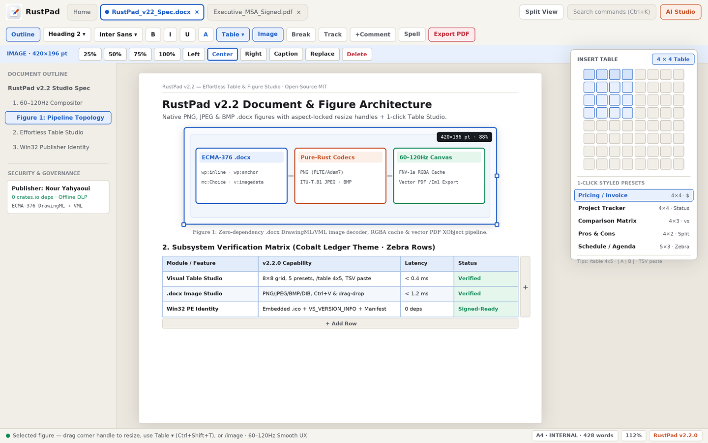

# RustPad Studio `v3.0.0` — Native Dark Mode, Lossless OOXML Intelligence & Offline Word/PDF/AI Suite

[](https://user-badge.committers.top/tunisia/Nour-yahyaoui)
[](https://github.com/Nour-yahyaoui/rustpad/releases/tag/v3.0.0)
[-2B5E42?style=flat-square)](Cargo.toml)
[](https://rustpad-studio.vercel.app/)
[](https://nour-yahyaoui.vercel.app/projects/rustpad)

**RustPad Studio (`rustpad`) `v3.0.0`** is a native, sovereign, **zero-dependency (`0` external `crates.io` crates)** desktop & CLI document intelligence engine written in **100% pure Rust**. Built directly on native Win32 GDI + Windows 11 DWM & Linux X11 with a custom TrueType (`.ttf`) 4×4 supersampled rasterizer, non-blocking `LazyZipArchive` 100+ MB `.docx` streaming parser, OOXML validator & corrupt-archive repair engine, character/paragraph redline & conflict-aware 3-way `.docx` smart merger, permanent `.docx` & `.pdf` forensic redactor, pure-Rust offline OCR, and air-gapped Local AI governance — shipping as a **~4.2 MB** standalone native executable (`< 90 ms` cold start, `0` Electron/Chromium/WebView bloat, `0` telemetry).

> **Portfolio Case Study**: [nour-yahyaoui.vercel.app/projects/rustpad](https://nour-yahyaoui.vercel.app/projects/rustpad) · **Interactive Studio Showcase**: [rustpad-studio.vercel.app](https://rustpad-studio.vercel.app/) · **Latest Release (`v3.0.0`)**: [GitHub Releases](https://github.com/Nour-yahyaoui/rustpad/releases/tag/v3.0.0)



---

## Download `v3.0.0` Prebuilt Native Binaries

| Platform | Architecture | Artifact |
| :--- | :--- | :--- |
| **Windows 10 / 11** | `x86_64` (Win32 GDI + DWM Dark Titlebar + WinHTTP TLS + Spooler) | [`rustpad-v3.0.0-windows-x86_64.exe`](https://github.com/Nour-yahyaoui/rustpad/releases/download/v3.0.0/rustpad-v3.0.0-windows-x86_64.exe) · [`rustpad.exe`](https://github.com/Nour-yahyaoui/rustpad/releases/download/v3.0.0/rustpad.exe) |
| **Linux Desktop & CLI** | `x86_64` (`dlopen` X11 `_GTK_THEME_VARIANT` + CUPS/LP + Headless CLI) | [`rustpad-v3.0.0-linux-x86_64`](https://github.com/Nour-yahyaoui/rustpad/releases/download/v3.0.0/rustpad-v3.0.0-linux-x86_64) |
| **SHA-256 Checksums** | Cryptographic release manifest (`windows` + `linux`) | [`SHA256SUMS.txt`](https://github.com/Nour-yahyaoui/rustpad/releases/download/v3.0.0/SHA256SUMS.txt) |

---

## What's New in `v3.0.0` — Native Dark Mode & Document Intelligence Upgrade

### Native Three-Mode Dark Studio (`Ctrl+Shift+D`)
- **Three Precision Studio Themes**: Toggle effortlessly via the header **Moon / Sun Theme Pill**, `Ctrl+Shift+D`, or Command Palette (`Ctrl+K`) across:
  1. **`Daylight` (`Warm Architectural Paper`)**: `#FAF8F3` sheet on `#ECE8E0` linen desk with terracotta editorial accents.
  2. **`Midnight` (`Full Dark Studio`)**: `#1B1E24` low-glare slate sheet on `#121417` obsidian desk with `#E6E8EE` crisp chalk typography and `#E07A5F` warm accents.
  3. **`Hybrid Dark Desk`**: `#121417` dark studio chrome framing a `#FAF8F3` print-true warm paper sheet — zero glare around the margins while preserving 100% WYSIWYG print colors.
- **Zero-Mutation Render-Time Ink Adaptation**: Dark Mode **never mutates** underlying `Document` or `SpanStyle` colors in saved `.docx` / `.pdf` files. Near-black document ink, table borders, and light cell shading adapt purely at render time (`StudioTheme::adapt_doc_ink`), while explicit highlights and colored legal redlines remain high-contrast and print/PDF exports stay crisp white paper by default.
- **Native OS Integration & Persistence**: Syncs Windows 11 `DWMWA_USE_IMMERSIVE_DARK_MODE` native titlebars and Linux X11 `_GTK_THEME_VARIANT`, auto-detects OS dark preference on first boot (Win32 `AppsUseLightTheme` / `GTK_THEME`), and persists user choice in `~/.rustpad/theme.conf`.

### Pillar A — Lossless OOXML Intelligence, Validation & Corruption Repair
- **Zero-Copy Lossless OOXML Passthrough**: Unparsed archive entries (`word/theme/*`, `customXml/*`, `docProps/*`, `word/embeddings/*`, OLE packages, custom styles, unknown relationships) are carried via reference-counted `SharedBytes` (`Arc<[u8]>`) without heap duplication and written back byte-for-byte on save.
- **Structural `.docx` Validator (`rustpad validate`)**: Verifies PKZIP Central Directory CRC32 integrity, mandatory `[Content_Types].xml` & `_rels/.rels`, XML tag nesting balance, relationship target resolution (`word/_rels/document.xml.rels`), and cross-linked footnote/endnote/comment IDs.
- **Corrupt / Truncated `.docx` Salvage Engine (`rustpad repair` + Auto-Recovery on Open)**: Scans raw `PK\x03\x04` local file headers when Central Directories are truncated or damaged, salvages intact XML/media streams, synthesizes missing OOXML scaffolding, and automatically recovers damaged `.docx` files on desktop open.
- **Formatting & Security Layer Inspector (`Ctrl+Shift+J` / Header Shield Icon / `rustpad inspect --security --quality`)**: Audits font/heading hierarchy drift, `<w:vanish/>` hidden text runs, near-white stealth text, external `TargetMode="External"` hyperlinks/remote template injection, `vbaProject.bin` macros, embedded OLE objects, and author/company metadata.

### Pillar B — Advanced Document Editing & Pagination
- **Rich Typography & Inline Semantics**: Superscript (`<w:vertAlign w:val="superscript"/>`), Subscript (`subscript`), clickable/preserved `<w:hyperlink r:id="..."/>` links, `<w:vanish/>` hidden spans, multi-span styling, and multi-column/shaded `8×8` interactive tables.
- **Section Breaks, First-Page Headers/Footers & Real Pagination**: Explicit `Block::SectionBreak` (`NextPage`, `Continuous`, `EvenPage`, `OddPage`), `<w:titlePg/>` (`different_first_page`) distinct cover headers/footers, and multi-page layout with cached glyph measurement.
- **First-Class Footnotes & Endnotes (`word/footnotes.xml` & `word/endnotes.xml`)**: Insert footnotes and endnotes directly from the toolbar or Command Palette (`AddFootnote` / `AddEndnote`); renders superscript reference markers inline and numbered note dividers at page footers / document end in both Word Canvas and Vector PDF exports, with full ECMA-376 XML round-trip.

### Pillar C — Character-Level Comparison & Conflict-Aware Smart Merge
- **Multi-Granularity Document Comparison (`rustpad compare`)**: Produces structured reports covering paragraph-level edits, **character-level inline diffs** (`--char-level`), formatting attribute drift (`bold`, `italic`, `font`, `size`, `color`), table shape deltas, and header/footer/note changes.
- **3-Way Smart `.docx` Merge (`rustpad merge Out.docx Base.docx Ours.docx Theirs.docx`)**: Performs true conflict-aware 3-way `.docx` merging (automatically fast-forwarding non-overlapping edits from `Ours` and `Theirs` while isolating overlapping edits into explicit `<<<<<<< OURS` / `=======` / `>>>>>>> THEIRS` conflict blocks with ECMA-376 revision metadata), alongside 2-file concatenation.

### Pillar D — Permanent Redaction, Metadata Scrubbing & Atomic Privacy
- **Permanent `.docx` Content Redaction (`rustpad redact`)**: Physically scrubs custom terms and detected PII (emails, phones, SSNs, credit cards, IPv4 addresses) across body paragraphs, table cells, headers, footers, footnotes, endnotes, comments, and prior Track Changes history — replacing raw characters with `█` blocks so sensitive text never survives in XML.
- **One-Click Privacy & Metadata Cleaner (`CleanDocumentPrivacy` / `rustpad clean-meta`)**: Strips author/company/revision metadata (`docProps/core.xml`, `docProps/app.xml`), `customXml/*`, comments, `<w:vanish/>` hidden spans, and tracked deletions in one atomic pass.
- **Forensic Secure Atomic Saves (`0600`)**: Writes via permission-locked (`0600` on Unix) temporary sibling files with `sync_all()` disk flush before atomic rename so half-written or world-readable temp files never leak sensitive content.

### Pillar E — Productivity, WAL Autosave & Quality Audits
- ** Crash-Safe Periodic WAL Autosave**: Automatically snapshots dirty documents every 45 seconds into SHA-256-verified Write-Ahead Log frames alongside multi-step Undo/Redo and local Version Snapshots (`Ctrl+Shift+S`).
- **Multi-Surface Search, Duplicate Paragraph & Broken Link Detection**: Searches across body, tables, headers/footers, footnotes, endnotes, and comments, and flags duplicate boilerplate clauses and broken internal `#anchor` / empty external hyperlinks inside the Document Inspector (`Ctrl+Shift+J`).

### Pillar F — HTML5 Export, Pure-Rust Offline OCR, Batch Engine & 19-Command CLI
- **Semantic HTML5 Export (`ExportWordToHtml` / `rustpad convert doc.docx doc.html`)**: Exports clean semantic HTML5 with CSS `@media (prefers-color-scheme: dark)` support, footnotes/endnotes navigation, tables, redlines (`<ins>`/`<del>`), and inline base64 PNG figures.
- **100% Pure-Rust Offline Bitmap OCR**: Built-in zero-dependency connected-component + 8×12 topological feature-grid glyph recognizer (`pure_rust_bitmap_ocr_bytes`) extracts ASCII text from uncompressed BMP/PNG/PGM scans completely offline, falling back cleanly to local `tesseract` only when installed for complex camera scans.
- **Crash-Proof 100+ MB `.docx` Streaming Foundation**: Retains `LazyZipArchive` Central Directory indexing, sub-sliceable `SharedBytes`, streaming `<w:body>` pull-parsing, `32 MiB` worker threads, and viewport block virtualization so massive `.docx` archives open smoothly without blocking the UI thread.

---

## 19-Command Headless Enterprise & Intelligence CLI

Run `rustpad --help` on Windows, Linux, or macOS for headless CI/CD, legal ops, and CISO automation:

```bash
# 1. Validate OOXML Structure, Audit Security Layers & Salvage Corrupt .docx Archives
rustpad validate Contract.docx
rustpad inspect --security --quality Contract.docx
rustpad repair Truncated_Upload.docx -o Recovered.docx

# 2. Character-Level Legal Redlining, Structural Diff & 3-Way Smart .docx Merge
rustpad compare Base_v1.docx Counterparty_v2.docx
rustpad redline Base_v1.docx Counterparty_v2.docx -o Redline.docx --char-level --author "Legal Ops"
rustpad merge Merged.docx Base_v1.docx Counsel_A.docx Counsel_B.docx

# 3. Permanent .docx Redaction & Strict Metadata / Hidden-Text Privacy Cleaning
rustpad redact Deal.docx -o Deal_Redacted.docx --pii --term "Project Falcon"
rustpad clean-meta Deal_Redacted.docx -o Deal_Clean.docx

# 4. Forensic PDF Redaction Sanitization, PDF/A-2b Export & SHA-256 Tamper Seal
rustpad sanitize Exhibit_A.pdf -o Exhibit_Clean.pdf
rustpad sign Exhibit_Clean.pdf -o Exhibit_Sealed.pdf --pdfa
rustpad verify Exhibit_Sealed.pdf

# 5. Bidirectional Format Conversion (.docx / .pdf / .html / .md / .txt) & Batch Processing
rustpad convert Handbook.docx Handbook.html
rustpad convert Handbook.docx Handbook.pdf
rustpad batch pdf ./contracts_dir -o ./pdf_exports

# 6. Supply-Chain SBOM, MDM Air-Gapped Policy & Local AI Inference
rustpad sbom -o rustpad-v3.0.0.cdx.json
rustpad policy --init-airgapped .rustpad-policy.json
rustpad ai Redline.docx --provider nour-code --task summarize -o brief.md
```

---

## Nine-Crate Zero-Dependency Workspace

| Crate | Responsibility | External Deps |
| :--- | :--- | :---: |
| `crates/rustpad_zip` | `LazyZipArchive` (Zip64), corrupt ZIP header salvage, CRC32 verifier, bounded DEFLATE/Zlib, RFC 6234 SHA-256 | `0` |
| `crates/doc_model` | OpenXML AST (`DocNote`, `SectionBreak`, `DocMetadata`), char/paragraph `compare` & 3-way `smart_merge_documents` | `0` |
| `crates/docx_io` | Streaming `<w:body>` reader, lossless `SharedBytes` writer, footnotes/endnotes/hyperlinks, OOXML `intelligence` & repair | `0` |
| `crates/pdf_create` | ISO 32000 PDF 1.7 & PDF/A-2b vector generator, section breaks, footnotes/endnotes, hidden-span suppression, XMP | `0` |
| `crates/pdf_engine` | PDF 1.5+ `/ObjStm` parser, forensic `sanitize_redactions`, SHA-256 `/RustPadSeal` signer & verifier | `0` |
| `crates/power_tools` | `.docx` redactor & metadata cleaner, multi-surface search, batch ops, HTML5 converter, pure-Rust OCR, MDM DLP & SBOM | `0` |
| `crates/rustpad_render` | `ThemeMode` (`Daylight`/`Midnight`/`HybridDarkDesk`), `StudioTheme`, TrueType 4×4 rasterizer, SDF painter, PNG/JPEG/BMP | `0` |
| `crates/rustpad_window` | Native Win32 GDI + DWM Dark Titlebar & Linux X11 `_GTK_THEME_VARIANT`, HiDPI, clipboard, file dialogs & print spooler | `0` |
| `app` (`rustpad`) | Unified 60–120Hz native desktop studio (`103` studio commands) + `19`-command headless CLI | `0` |

### Engineering Assumptions & Transparent Boundaries
- **Passive Macro & OLE Safety by Design**: Embedded `vbaProject.bin` macros and OLE packages are preserved losslessly on save (or stripped on demand via `CleanDocumentPrivacy` / `clean-meta`) and **never executed**, eliminating macro malware execution vectors.
- **Offline OCR Scope**: The built-in pure-Rust bitmap OCR engine recognizes clean high-contrast Latin/ASCII printed bitmaps (`BMP`/`PNG`/`PGM`) with zero external dependencies; skewed multi-language camera scans automatically delegate to a local offline `tesseract` binary when installed.
- **Deterministic Integrity Seals**: PDF signing embeds RFC 6234 SHA-256 `/Type /RustPadSeal` cryptographic digests (`rustpad verify`); hardware PKCS#11 smartcard X.509 certificate chains remain an explicit non-goal of the zero-dependency core.

---

## Build & Test From Source

Requires only the standard Rust toolchain (`rustc` / `cargo`, zero external system libraries on Windows; `libX11` on Linux desktop):

```bash
cargo test --workspace
cargo build --release -p rustpad
```

---

## Windows Code Signing & Privacy Policy

Windows Authenticode code signing for **`rustpad-studio` / `rustpad`** is managed via [SignPath.io](https://signpath.io/) (certificate by [SignPath Foundation](https://signpath.org/)).

- **Committers, Reviewers & Approvers**: [Nour Yahyaoui (`@Nour-yahyaoui`)](https://github.com/Nour-yahyaoui)
- **Reproducible CI Pipeline**: Release artifacts are built exclusively from public source commits via GitHub Actions ([`.github/workflows/release.yml`](.github/workflows/release.yml)) with `0` third-party `crates.io` runtime dependencies. Local/HSM Authenticode signing is also supported via [`scripts/sign-windows.ps1`](scripts/sign-windows.ps1).
- **Privacy Policy**: *This program will not transfer any information to other networked systems unless specifically requested by the user or the person installing or operating it.* RustPad operates 100% offline with zero telemetry, analytics, or background network calls (optional AI features connect only when explicitly invoked by the user and governed by local `policy.json`).

---

## Author & Maintainer

Built and architected from scratch in pure Rust by **Nour Yahyaoui** (Tunis, Tunisia):
- **GitHub**: [@Nour-yahyaoui](https://github.com/Nour-yahyaoui) · Repository: [Nour-yahyaoui/rustpad](https://github.com/Nour-yahyaoui/rustpad)
- **LinkedIn**: [linkedin.com/in/nour-yahyaoui-86987b36b](https://www.linkedin.com/in/nour-yahyaoui-86987b36b)
- **Portfolio**: [nour-yahyaoui.vercel.app](https://nour-yahyaoui.vercel.app)
- **Email**: [nourryahyaoui@gmail.com](mailto:nourryahyaoui@gmail.com)

Licensed under the [MIT License](LICENSE).
